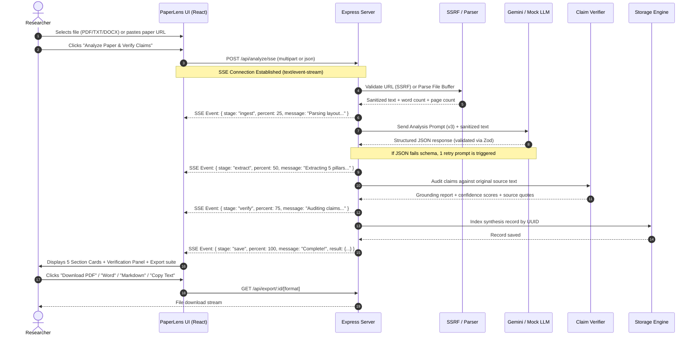

# PaperLens Workflow & Architecture Specification

PaperLens operates on a multi-stage streaming pipeline engineered for factual fidelity and anti-hallucination in academic research synthesis.

---

## 1. System Architecture

```mermaid
graph TD
    Client["React 18 + Vite Frontend<br/>(3-Step Wizard: Upload → Analyse → Results)"]
    API["Express REST & SSE Gateway<br/>(:5001)"]
    SSRF["SSRF Guard<br/>(Private IP & Metadata Block)"]
    Parsers["Document Parsers<br/>(pdf-parse / mammoth / word-extractor / readability)"]
    LLMService["Swappable LLM Service"]
    Gemini["Google Gemini API<br/>(T=0.1, Structured JSON, 1-Retry)"]
    Mock["Intelligent Keyless Mock<br/>(Empirical Extraction & Grounding)"]
    Verifier["Factual Grounding Verifier<br/>(Dual-Pass Claim Concordance)"]
    Storage["Session & Memory Store<br/>(UUID Index)"]
    Exporters["Academic Export Engine<br/>(Markdown, PDFKit, Docx)"]

    Client -->|1. File Upload / URL| API
    API -->|URL Validation| SSRF
    API -->|Parse Buffer| Parsers
    Parsers -->|Sanitized Text| API
    API -->|Stage 1: Ingest (25%)| Client

    API -->|Structured Extraction| LLMService
    LLMService -->|Key Present| Gemini
    LLMService -->|Keyless / Mock Mode| Mock
    Gemini -->|Validated Schema| API
    Mock -->|Validated Schema| API
    API -->|Stage 2: Extract (50%)| Client

    API -->|Claims + Raw Source| Verifier
    Verifier -->|Confidence & Citations| API
    API -->|Stage 3: Verify (75%)| Client

    API -->|Persist Result| Storage
    API -->|Stage 4: Save (100%)| Client

    Client -->|Download .md / .pdf / .docx| Exporters
    Exporters -->|Stream Binary| Client
```

---

## 2. End-to-End SSE Sequence Flow



---

## 3. The 4-Stage Pipeline Breakdown

### Stage 1: Ingest (0% – 25%)
- **Objective**: Ingest arbitrary academic files and extract high-cleanliness text while defending infrastructure.
- **Security Check**: For URLs, DNS resolution is inspected via `ipaddr.js` to block loopback (`127.0.0.1`), metadata endpoints (`169.254.169.254`), and private RFC 1918 networks (`10.0.0.0/8`, `172.16.0.0/12`, `192.168.0.0/16`).
- **Parsing**:
  - `pdf-parse` extracts text. If non-whitespace characters are $< 60$, it raises `SCANNED_OR_EMPTY_PDF` informing the user that OCR is needed.
  - `mammoth` extracts DOCX runs.
  - `word-extractor` extracts legacy DOC bodies.
  - `@mozilla/readability` with `jsdom` extracts web articles.
- **Normalization**: Cleans line breaks, multiple whitespace runs, and generates word counts.

### Stage 2: Extract (25% – 50%)
- **Objective**: Deconstruct the paper into the 5 core academic pillars.
- **Prompt Execution**: Analyzes text using Prompt Version 3 (`analysis-v3.ts`), instructing the LLM to adhere to strict negative constraints (no ungrounded speculation, explicit metrics, empty arrays when omitted).
- **Zod Schema Validation**: Enforces string length, non-empty arrays, and metric types.
- **1-Retry Recovery**: If the LLM generates invalid JSON or misses fields, a targeted repair prompt (`buildJsonRepairPrompt`) is automatically executed.

### Stage 3: Verify (50% – 75%)
- **Objective**: Mitigate hallucinations by auditing claims against the original document.
- **Grounding Pass**: Inspects Problem statements, Objectives, Methodology design, empirical Findings, and Limitations.
- **Scoring**: Computes overall confidence score ($0-100\%$), assigns claim status (`verified`, `partially_verified`, `unverified`), and extracts direct quotes (`sourceQuote`) with line/paragraph context.

### Stage 4: Save & Export (75% – 100%)
- **Objective**: Index the grounded record and provide multi-format distribution.
- **Storage**: In-memory store indexed by UUID, accessible via `GET /api/analysis/:id`.
- **Export Formats**:
  - **Markdown**: Clean academic markdown format with YAML-style metadata callouts.
  - **Word (.docx)**: Generated via `docx` library with styled headings, callouts, and bullet lists.
  - **PDF (.pdf)**: Rendered via `pdfkit` featuring deep navy headers, gold typography, and verification audit stamps.
  - **Clipboard**: Formatted markdown instantly copied to system clipboard.
